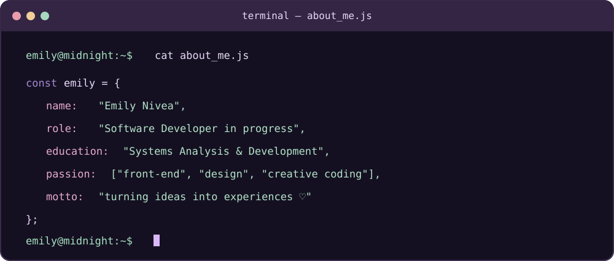

<div align="center">



<br>

### welcome to my little universe ♡

`software developer` · `front-end enthusiast` · `creative mind`

<a href="https://thenivea.netlify.app">portfolio</a> &nbsp;✦&nbsp;
<a href="https://github.com/sweetie-dev">github</a>

</div>

<br>



<br>

## ✦ explorer / my-projects



<div align="center">

| project | description | access |
|:---|:---|:---:|
| **S.I.G.A.** | Smart waste management and environmental solutions | [explore]((https://github.com/lidiatapajos/S.IG.A)) |
| **Movies & Musics** | A universe for movie and music lovers | [explore](https://moviesandmusic.netlify.app) |
| **NewBank** | Modern banking interface built with React | [repositories](https://github.com/sweetie-dev?tab=repositories) |
| **Portfolio** | My creative corner on the web | [visit](https://thenivea.netlify.app) |

</div>

<br>

## ✦ system / installed-technologies

<div align="center">

### 01. front-end.exe


<br><br>

### 02. back-end.exe


<br><br>

### 03. database.exe


<br><br>

### 04. mobile-and-creative.exe


<br><br>

### 05. dev-tools.exe


</div>

<br>

## ✦ system / current-status

```javascript
const emily = {
  education: "Systems Analysis and Development - ADS",

  focus: [
    "Front-end Development",
    "Back-end Development",
    "UI/UX",
    "Web Development"
  ],

  currentlyLearning: "A little bit of everything",

  loves: [
    "Creative projects",
    "Music",
    "Technology"
  ],

  status: "Always learning and building something new ♡"
};

console.log("Thanks for visiting my little universe!");
```

<br>

<div align="center">

**connect.exe**

<a href="https://thenivea.netlify.app">
  
</a>

<a href="https://github.com/sweetie-dev">
  
</a>

<br><br>

`[ system message ]`

</div>

<br>

<div align="center">
  
</div>
